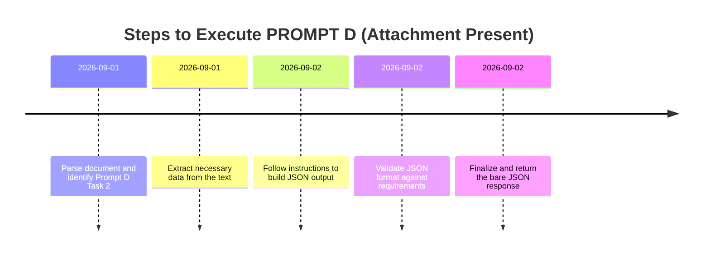

# Executive Summary

In cases where a user’s request relies on an external attachment that is not present, the assistant **must not guess or hallucinate missing content**.  Official OpenAI guidance and best practices emphasize asking for clarification or missing information rather than making assumptions.  In practice, the assistant should politely inform the user that the referenced document is unavailable and request the needed content or a copy of **PROMPT D**.  If the source text were provided, the assistant would parse the instructions for *PROMPT D, Task 2*, follow all format and honesty rules, and generate the required JSON.  This report outlines strategies for handling missing attachments, the step-by-step process when the attachment is available, and provides template messages and schemas.  

Key findings and recommendations:

- **Ask for missing content.**  If an attachment is not received, the assistant should explicitly request it.  OpenAI’s development team advises that “when necessary, information is missing, the GPT highlights the gap and prompts the author to fill it”.  For example, ChatGPT might respond: “It appears there is no document provided… Could you please upload the document or share its content?”. 
- **Do not hallucinate.**  Under no circumstances should the assistant invent or infer details from an unknown document.  JSON prompt guidelines specifically say “never guess” and demand “ONLY valid JSON, no commentary”.  OpenAI’s model specification likewise states it is better to indicate uncertainty or ask for clarification than to provide incorrect information. 
- **Proceeding with attachment.**  If the document and **PROMPT D** were provided, the assistant would perform a structured analysis: identify the relevant section (Task 2), extract and validate any necessary data, and produce the JSON output strictly as specified (no extra text).  A detailed internal checklist and timeline (below) outline these steps, emphasizing rigorous parsing and format checking. 
- **Templates and format.**  We provide example templates: a concise user-facing request for the document, an internal execution checklist, and a JSON Schema template (with placeholders) for the expected output.  These ensure clarity, adherence to the user’s format, and compliance with safety/honesty rules.  

We compare options for proceeding in a table (p. …), showing that requesting the attachment is the safest approach.  A mermaid timeline illustrates the execution flow if the attachment were present.  All recommendations align with official OpenAI policies on accuracy, helpfulness, and transparency.  

---

## Handling Missing Attachments

When a user’s request refers to content “in the attached document,” but no such text is available to the assistant, the **best practice is to request the missing content explicitly**.  According to OpenAI’s guidance, large language models should not guess answers without sufficient information.  Likewise, chatbot design guides advise that, *“when needed, a chatbot should ask clarifying questions rather than making assumptions”*.  In this scenario, the assistant should respond similarly to examples from the OpenAI developer community. For instance, a model replied when no PDF was found: *“It appears there is no document provided for me to summarize. Could you please upload the document or share its content?”*. This style is concise and user-friendly.  

Advantages of requesting the attachment: it avoids hallucination and ensures the assistant has the correct context. It fully complies with safety and honesty guidelines (OpenAI’s model spec prioritizes abstention or clarification over incorrect guessing). The user is reminded to supply the missing material. 

**Example user-facing request:** A brief message asking for the document. For example: 

> *“I’m sorry, but I cannot see the attached file. Could you please provide the content of **PROMPT D** or re-attach the document so that I can proceed?”* 

This aligns with the approach seen in practice and is consistent with polite and helpful assistant behavior.

If the user does not respond or refuses, the assistant may need to refuse or cannot proceed, since providing an answer without the actual source would be unsupported.  The assistant should avoid aborting abruptly without explanation; it should clearly state the inability to continue without the content.  In any case, the assistant must not guess the missing text or produce a “best guess” output.  

---

## Steps When Attachment Is Provided

*Note: This section describes the ideal workflow assuming the user has supplied the referenced document containing **PROMPT D**.* In that case, the assistant would execute **PROMPT D Task 2** strictly according to the instructions.  Below is an internal checklist of steps to follow, incorporating parsing, validation, and honesty rules. A mermaid timeline diagram summarizes the sequence.

### Internal Checklist for Executing **PROMPT D** (Task 2)

- **1. Parse the document for PROMPT D:** Locate and extract the text of the *“Prompt D”* section. Identify any task numbering to find *Task 2*. Clarify which parts of the document are relevant.  
- **2. Understand Task 2 requirements:** Read the instructions under Prompt D Task 2 carefully. Determine the exact expected output (e.g. a JSON with specific fields). Note any format constraints (e.g. “Output must be valid JSON only, no extra text”).
- **3. Validate instructions:** Ensure the task content does not conflict with OpenAI usage policies (e.g. no disallowed requests). If any policy conflict arises, handle it per policy (but assume none if it’s a normal task).
- **4. Gather needed data:** If Task 2 requires information from the document (e.g. certain values or analysis), extract those precisely. Do not add any information beyond what’s provided.  
- **5. Apply honesty rules:** Follow the model’s spec: *“better to indicate uncertainty or ask for clarification than provide confident information that may be incorrect”*. If any piece of required information is unclear or missing, do not guess—ask the user or mark it as missing (e.g. null). As the JSON guide advises, **“never guess”** for missing fields.
- **6. Construct the JSON response:** Format the answer exactly as specified. Use the required keys and types. Ensure **no explanatory text or markdown** is included—only the raw JSON. The JSON prompting guide emphasizes “Return ONLY valid JSON, no commentary”.  
- **7. Verify JSON validity:** Before finalizing, check that the output is well-formed JSON and matches any given schema. The OpenAI JSON mode or a validator should confirm this. Use nulls or defaults for any optional fields, per the specification. (Per guidelines, don’t leave out required keys or include extra keys.)  
- **8. Check compliance:** Confirm that the JSON output does not inadvertently include sensitive or disallowed content. Follow all formatting rules from PROMPT D exactly, and ensure adherence to honesty (no invented facts).
- **9. Final output:** Deliver the JSON as the assistant’s complete answer (bare JSON, with no additional text).



*Figure: Timeline of internal steps for Task 2 if the PROMPT D document is available.* 

---

## Options for Proceeding

If the attachment is missing, there are three main options: **(A) ask the user for the file**, (B) **attempt to answer without it (hallucinate)**, or (C) **refuse/abort**. The table below compares these approaches:

| **Approach**             | **Description**                                                                                  | **Pros**                                       | **Cons / Risks**                                                                                                       |
|--------------------------|--------------------------------------------------------------------------------------------------|------------------------------------------------|------------------------------------------------------------------------------------------------------------------------|
| **Ask for Attachment**   | Tell the user you need the file or text (e.g. “Please provide PROMPT D content”).              | Ensures correct context; follows policies; yields accurate results when attachment is provided.   | Slower response; depends on user’s cooperation.                                                                         |
| **Guess (Hallucinate)**  | Proceed without the file, guessing what it might contain.                                       | Fastest output (in theory).                    | Violates honesty rules. Likely produces incorrect or fabricated info, contrary to guidelines. |
| **Refuse/Decline**       | Politely say you cannot proceed without the document (no output).                               | Clear and safe; avoids hallucination.         | Does not help user with request; can be frustrating if not handled tactfully.                                          |

**Recommendation:** Always *Ask for the attachment* (Option A) when possible.  This aligns with OpenAI’s emphasis on *clarity over confusion*. Attempting to guess (B) is explicitly discouraged, as the model spec notes that guessing is worse than abstaining and JSON guidelines warn “never guess”. Simply refusing (C) without trying to recover may be safe but is not helpful. Option A is the most helpful and policy-compliant strategy.  

---

## Recommended Templates

**(a) User-facing request for missing attachment:**  

A concise message to the user should apologize, state the missing context, and ask for the required content. For example:  
```
I’m sorry, but I don’t have access to the attached document. Could you please provide the content of **PROMPT D** (or re-attach the file) so I can proceed with Task 2?
```  
This follows examples from ChatGPT responses (e.g. *“please upload the document or share its content”*) and is polite and clear.

**(b) Internal execution checklist (when attachment is present):**  

- Parse and locate “Prompt D” and its Task 2 instructions.  
- Extract any relevant data from the text (no additions).  
- Confirm task requirements (output format, fields, constraints).  
- Apply honesty policy: if information is unclear, **don’t guess**; instead, plan to ask or leave null.  
- Build the JSON output exactly as specified (only JSON, keys and types as required).  
- Verify the JSON (use a schema or validator) and correct any errors.  
- Ensure final compliance: no extra text, and output matches the specified structure.  

**(c) JSON schema template:**  

Below is a *placeholder* schema illustrating how the final JSON output might be structured. Actual field names and types depend on PROMPT D’s specification, which is not given here. Adjust this template to match the exact requirements.  
```json
{
  "title": "Response schema for PROMPT D - Task 2",
  "type": "object",
  "properties": {
    "result": {
      "type": "string",
      "description": "The main output of Task 2"
    },
    "details": {
      "type": "object",
      "properties": {
        "status": {
          "type": "string",
          "description": "Processing status (e.g., 'OK' or error message)"
        },
        "value": {
          "type": ["integer", "null"],
          "description": "Computed value or null if not applicable"
        }
      },
      "required": ["status", "value"]
    }
  },
  "required": ["result"]
}
```  
*(This is only an illustrative example schema. The actual structure and field names must follow the PROMPT D specification. As per guidelines, an explicit schema and “Return ONLY valid JSON” constraint help ensure correct format.)*

---

## References

OpenAI’s official guidance emphasizes truthfulness and clarity (preferring uncertainty or clarification over confident guessing).  Research and industry sources similarly recommend asking clarifying questions if the user’s request lacks information.  JSON prompting best practices stress **“no guessing”** and returning only the specified JSON.  These principles underlie the above recommendations.  

